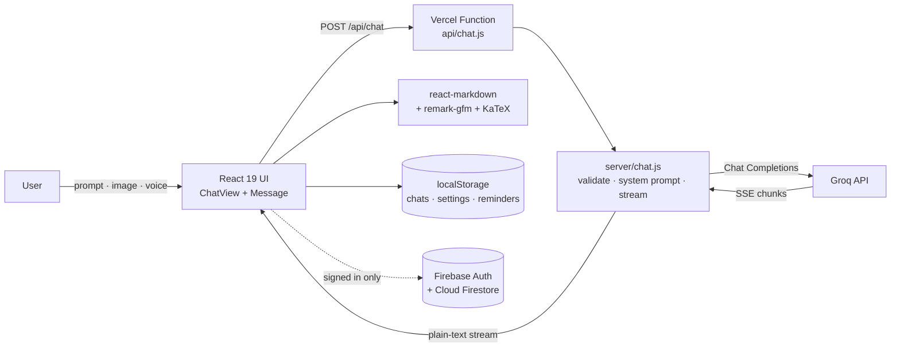

<div align="center">

# CortexAI

**A fast, polished, mobile-first AI chat app — streaming answers, images, voice, and cloud sync.**

[](https://react.dev)
[](https://vite.dev)
[](https://tailwindcss.com)
[](https://groq.com)
[](https://firebase.google.com)

**[Live demo → cortexai-three.vercel.app](https://cortexai-three.vercel.app)**

Built by **Shivam Kumar** · [GitHub](https://github.com/shivamkumar0097) · [LinkedIn](https://www.linkedin.com/in/shivamkumar0097)

</div>

---

## Why CortexAI?

Most AI chat UIs either feel like a demo or bury the good stuff behind settings. CortexAI is built around three ideas:

1. **It feels instant** — token-by-token streaming with chunked rendering, no blocking spinners.
2. **It stays useful** — bookmarks, image history, reminders, model switching, and a built-in feature panel.
3. **It works everywhere** — a real responsive layout, installable PWA, and a local-first storage model with optional Firestore sync.

No heavy framework, no database bill to start. One serverless function, one API key, and you are running.

---

## Highlights

| Area | What you get |
| --- | --- |
| **Conversation** | Streaming replies, stop/regenerate, AI-generated titles, model switching, editable chat names |
| **Multimodal** | Attach images (Groq vision) and text files, tap-to-preview, download attachments |
| **Input** | Type, browser speech recognition, or paste — with a mobile-aware composer |
| **Reasoning** | Think mode adjusts temperature/token budget for deeper, step-by-step answers |
| **Knowledge** | Markdown (GFM), tables, fenced code, and LaTeX math via KaTeX |
| **Voice out** | Read any reply aloud with the Web Speech API |
| **Organization** | Search chats, bookmark replies into Library, collect images, set local reminders |
| **Identity** | Email/password + Google sign-in, cloud sync to Firestore when authenticated |
| **Control** | Plugins panel toggles features live; settings for model and system prompt |
| **Delivery** | Vercel serverless API, PWA manifest, offline-safe service worker cleanup |

---

## Architecture



**Why this shape?**

- `server/chat.js` holds all the logic. Vite's dev/preview middleware and the Vercel function both call the same handler, so local and production behave identically.
- The Groq key never reaches the browser — it is read from `process.env` on the server only.
- The upstream SSE stream is decoded and re-emitted as plain text, so the client stays framework-agnostic.
- Everything is local-first; Firebase is an enhancement, not a requirement.

### Request lifecycle

1. Client sends `POST /api/chat` with recent messages, model, system prompt, and flags.
2. Handler validates the method, key, and payload; trims history to the last 30 messages and each message to 8k chars.
3. If any message contains an image, the vision model is selected automatically (`GROQ_VISION_MODEL`).
4. The system prompt is assembled: identity/credit rules + think-mode + image instructions + user's custom prompt.
5. Groq is called with `stream: true`; `data:` lines are parsed, and text deltas are written straight to the response.
6. The browser renders the growing string as Markdown, with code, tables, and math formatted on the fly.
7. A separate `mode: "title"` call generates the chat title from the first message.

---

## Quick start

### Prerequisites

- **Node.js 20.19+** or **22.12+** (Vite 8 requirement)
- A [Groq](https://console.groq.com) API key
- A Firebase project — *optional*, only for sign-in and cloud sync

### Run locally

```bash
git clone https://github.com/shivamkumar0097/CortexAI.git
cd CortexAI
npm install
cp .env.example .env      # Windows PowerShell: copy .env.example .env
npm run dev
```

Open **http://localhost:5173**, add `GROQ_API_KEY` to `.env`, and start chatting.

| Script | Description |
| --- | --- |
| `npm run dev` | Dev server + local `/api/chat` middleware on port `5173` |
| `npm run build` | Production build into `dist/` |
| `npm run preview` | Preview build + API middleware on port `4174` |

---

## Environment variables

Copy `.env.example` to `.env`. Only the first variable is required.

| Variable | Required | Description |
| --- | --- | --- |
| `GROQ_API_KEY` | **Yes** | Server-side Groq key. Never prefix with `VITE_`. |
| `GROQ_MODEL` | No | Text model id. Default: `openai/gpt-oss-120b` |
| `GROQ_VISION_MODEL` | No | Model used when an image is attached. Default: `qwen/qwen3.8-27b` |
| `VITE_FIREBASE_API_KEY` | No | Firebase web API key |
| `VITE_FIREBASE_AUTH_DOMAIN` | No | Firebase auth domain |
| `VITE_FIREBASE_PROJECT_ID` | No | Firebase project id |
| `VITE_FIREBASE_STORAGE_BUCKET` | No | Firebase storage bucket |
| `VITE_FIREBASE_MESSAGING_SENDER_ID` | No | Firebase messaging sender id |
| `VITE_FIREBASE_APP_ID` | No | Firebase app id |

Without Firebase values the app runs fully in local mode — the auth buttons simply show a setup hint.

---

## API reference

### `POST /api/chat`

```json
{
  "messages": [
    { "role": "user", "content": "Explain closures in JavaScript" }
  ],
  "model": "openai/gpt-oss-120b",
  "systemPrompt": "Optional custom instructions",
  "think": false
}
```

Image messages use the multimodal shape:

```json
{
  "role": "user",
  "content": [
    { "type": "text", "text": "What is in this image?" },
    { "type": "image_url", "image_url": { "url": "data:image/png;base64,..." } }
  ]
}
```

**Response:** `200 text/plain; charset=utf-8` — streamed text chunks.

| Error | Meaning |
| --- | --- |
| `400` | Invalid payload or no messages |
| `405` | Non-POST request |
| `502` | Upstream Groq request failed |
| `503` | `GROQ_API_KEY` missing or still the placeholder |

### Title generation

```json
{ "mode": "title", "text": "First user message" }
```

Returns `{ "title": "Generated Title" }` (fails soft to `""`).

---

## Data & persistence

| Store | Key | Contents |
| --- | --- | --- |
| `localStorage` | `cortexai:conversations` | Chats, messages, attachments |
| `localStorage` | `cortexai:settings` | Model, feature toggles, system prompt |
| `localStorage` | `cortexai:scheduled` | Local reminders |
| Cloud Firestore | `users/{uid}` | Synced conversations and settings (signed-in only) |

Local images are merged back into cloud conversations on restore, so an attachment added offline is not lost after sign-in.

---

## Project structure

```
.
├── api/
│   └── chat.js                 # Vercel serverless entry point
├── server/
│   └── chat.js                 # Shared handler: validation, prompts, streaming
├── src/
│   ├── App.jsx                 # Conversations, streaming state, persistence, sync
│   ├── components/
│   │   ├── AuthModal.jsx       # Email + Google sign-in
│   │   ├── ChatView.jsx        # Composer, model picker, empty state
│   │   ├── Message.jsx         # Markdown, attachments, message actions, TTS
│   │   ├── Panels.jsx          # Images, Library, Scheduled, Plugins, Explore
│   │   ├── SettingsModal.jsx   # Model, system prompt, clear data
│   │   ├── Sidebar.jsx         # Nav, search, rename/delete, profile menu
│   │   ├── ErrorBoundary.jsx   # Crash screen with cache reset
│   │   └── Toaster.jsx         # Toast notifications
│   ├── lib/
│   │   ├── firebase.js         # Auth + Firestore helpers
│   │   ├── storage.js          # Local persistence, models, defaults
│   │   └── toast.js            # Tiny event bus
│   ├── index.css               # Theme and component styles
│   └── main.jsx                # React root + service worker cleanup
├── public/                     # PWA manifest, icons, self-uninstalling SW
├── index.html
├── vite.config.js              # React + Tailwind + local API middleware
└── .env.example
```

---

## Deployment

1. Import the repository into **Vercel**.
2. Add `GROQ_API_KEY` and optionally `GROQ_MODEL` / `GROQ_VISION_MODEL` as environment variables.
3. Add the `VITE_FIREBASE_*` values if you want auth and sync.
4. Add your deployment domain to **Firebase Authentication → Authorized domains**.
5. Deploy. `api/chat.js` becomes the `/api/chat` serverless function; `dist/` is served statically.

> Never put `GROQ_API_KEY` in a `VITE_` variable — it would be embedded in the browser bundle.

---

## Security notes

- `.env` is gitignored; no keys are committed.
- The Groq key is read only on the server. Firebase web config is public by design — protect data with Firestore rules.
- Incoming messages are sanitized: roles are whitelisted, content is length-capped, and only text/image parts are forwarded.
- The identity/credit instructions live in the server-side system prompt, so they apply to every reply regardless of client input.

---

## Troubleshooting

| Symptom | Fix |
| --- | --- |
| **Old UI or `ReferenceError` from a hashed `index-*.js` after deploy** | A stale service worker / cached bundle is still running. Use the **Clear cache & reload** button on the crash screen, or DevTools → Application → Storage → **Clear site data**, then hard reload. The app auto-unregisters service workers on load. |
| **`Add GROQ_API_KEY to .env`** | Set the key in `.env` (local) or Vercel environment variables (production) and restart/redeploy. |
| **Auth buttons show a setup hint** | The `VITE_FIREBASE_*` variables are missing or incomplete. |
| **Reminders do not fire when the tab is closed** | Expected — reminders are local timers that work while the app is open. |
| **Blank page on first load** | Hard reload once; cached assets from an older PWA version are the usual cause. |

---

## Roadmap

- [ ] Real web search with cited sources (Tavily / Brave, opt-in toggle)
- [ ] Export conversations to Markdown / PDF
- [ ] Global command palette (`Ctrl+K`)
- [ ] Chat folders and tags
- [ ] Theme / accent color picker
- [ ] Read-only public share links for replies
- [ ] Side-by-side multi-model comparison
- [ ] Usage and token dashboard

---

## Contributing

Issues and pull requests are welcome. For local development, follow **Quick start**, keep changes focused, and run `npm run build` before opening a PR.

---

## Author

**Shivam Kumar** — developer building polished, real-world web products.

- GitHub: [shivamkumar0097](https://github.com/shivamkumar0097)
- LinkedIn: [shivamkumar0097](https://www.linkedin.com/in/shivamkumar0097)
